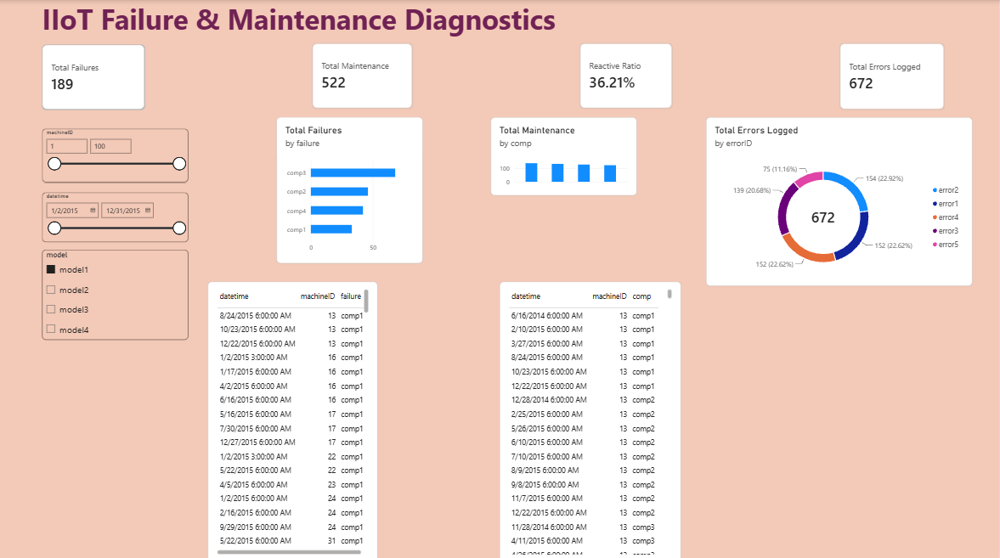
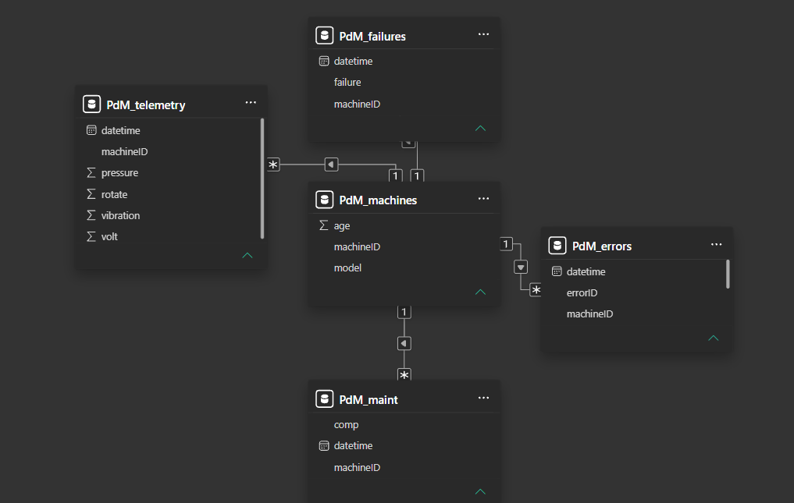

# Industrial IoT & Predictive Asset Maintenance Intelligence System

Multi-tiered Power BI intelligence architecture designed to monitor real-time health, detect telemetry anomalies, and diagnose component failures across an industrial fleet of 100 machines (**876K+ telemetry records**).

## Dashboard Preview

## Data Architecture & ETL
- **Data Ingestion & Transformation:** Built automated ETL pipelines in **Power Query (M)** with schema enforcement and type conversion across 5 tables (`PdM_machines`, `PdM_telemetry`, `PdM_errors`, `PdM_failures`, `PdM_maint`).
- **Data Modeling:** Structured a **1:N Star Schema** linking machine metadata to high-frequency sensor logs (voltage, rotation, pressure, vibration), warning codes, and maintenance records.
- **Analytics & DAX:** Engineered custom DAX measures for failure density, rolling telemetry averages, and reactive maintenance ratio (**36.21%**), alongside Key Influencers and Decomposition Tree visuals.

## Key Business Insights
- **Primary Bottleneck:** Subsystem `comp2` accounts for **34%** of all machine breakdowns across the fleet.
- **Early Warning Precursors:** `error1` and `error2` represent **50%+** of logged warnings preceding component failures.
- **Aging Fleet Risk:** Machines aged **12–20 years** exhibit a **68% surge** in failure probability.